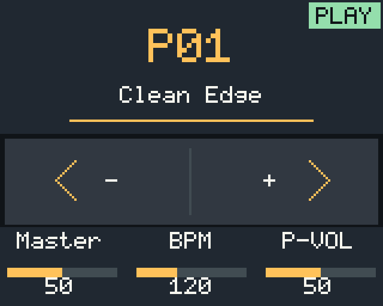
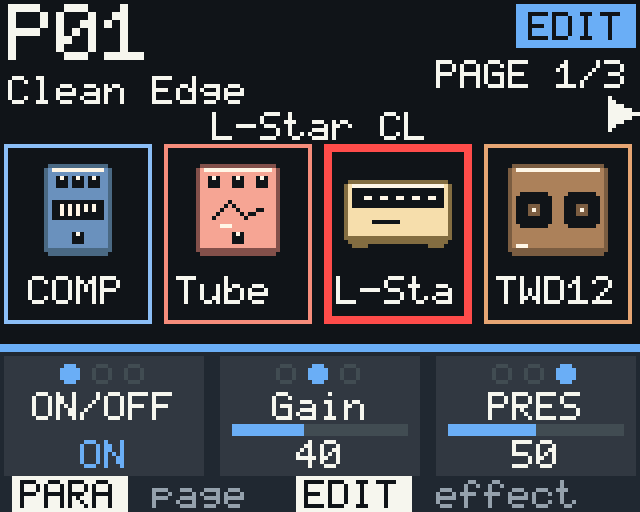
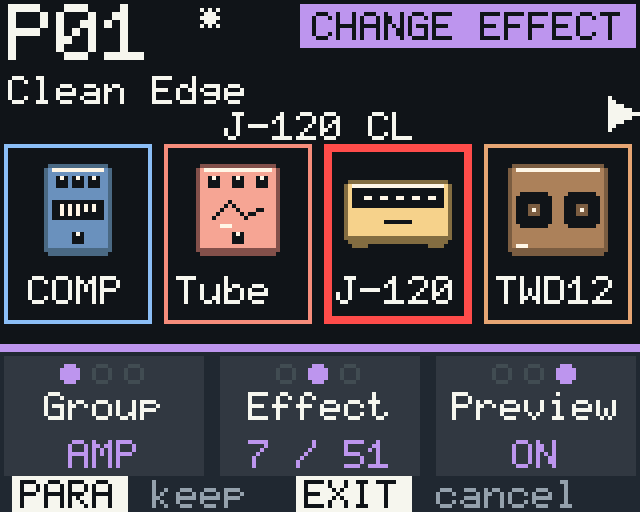
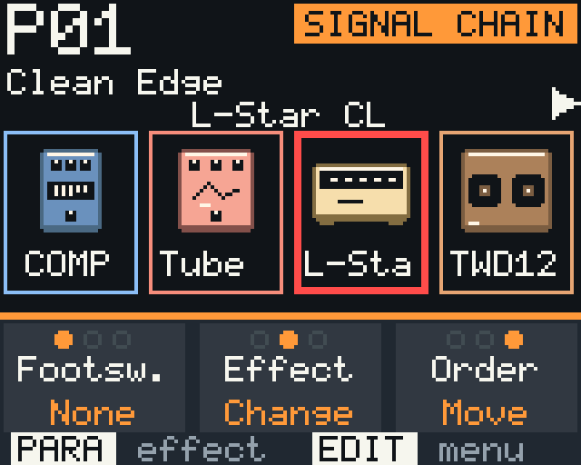

# gp100-mods

A desktop app that builds firmware for the Valeton GP-100 pedal: **OpenGP100** (recommended) or Valeton's original firmware
with a few mods. You install the result with the **official GP-100 app**; no J-Link, no compiler. Valeton's bootloader and
footswitch+PARA recovery stay untouched.

<p>
  
  
  
  
</p>

> **Unofficial.** Not affiliated with Valeton. Flashing can leave a device unusable; read [docs/recovery.md](docs/recovery.md)
> first. Every firmware update erases the presets on the pedal.

## Why OpenGP100 (recommended)

OpenGP100 is a community firmware written from scratch by Aleksey Khristolyubov (Reddit: Natural-Mechanic7484). Compared to
the original firmware it has:

* **A better UI.** Mode tags in color, one list for choosing effects (with live preview while you scroll), EDIT changes the current
  effect directly, EXIT always goes back, and an on-pedal guide (hold GLOBAL). See [pedal-ui](docs/pedal-ui.md).
* **An editable signal chain.** Add, remove and reorder effects freely.
* **Any preset in any slot.**
* **Any effect in any position**, even the same effect several times in one chain.
* **New pedal/effects simulations.** Six new effects: Studio Comp, Limitter, Muff, Octaver2, Balls and Envelope, plus a global output limiter. See [new effects](docs/new-effects.md).

**Trade-off:** while OpenGP100 is installed, the official GP-100 app only shows "Device Connected" and can't edit patches.
To use it again, flash another firmware in **recovery mode** ([docs/recovery.md](docs/recovery.md)): one made by this app, or
Valeton's official one.

This app can convert your Valeton `.prst` presets and install them with OpenGP100.

The "Original firmware + mods" mode keeps the normal app workflow (V-Wah/C-Wah in the MOD slot, finer MASTER volume, custom
About text, boot animation), but has a **known bug** when you swap out the wah and the chorus.

## Using the app

Run the packaged **GP-100 Firmware Builder**, or from source: `pip install -e ".[app]"`, `python -m gp100mods.app`
(Python 3.10+).

1. On first run, give it your copy of Valeton's official **GP-100 Firmware V2.1** (the GP-100 app can download it). It checks
   the SHA-256, refuses anything else and keeps a local copy. Nothing is uploaded.
2. Pick a mode. For OpenGP100 you can tick **Finer MASTER volume steps**, keep or untick **live preview** of effects while browsing the effect list, keep or untick the **new drum sounds**
   (on by default; untick for Valeton's original drum sounds; the rhythms are always Valeton's), add `.prst` presets (installed in P01, P02, ...)
   and choose a boot animation.
3. Click **Generate firmware** and install the file with the official GP-100 app like any update.

**Tested:** firmware V2.1 and GP-100 app 1.5.0, on Windows and WSL. **Not tested:** other app versions, macOS, native Linux.
Please report what happens if you try them.

**Before you flash:** back up your presets, keep the pedal powered and the USB cable untouched, and know the recovery steps.

## How it works

An update file has a header and four sections. In OpenGP100 mode, section 0 (the main program) is the bundled OpenGP100 build
and everything else is from your official file; in original+mods mode, section 0 is your official file, patched.

* [`firmware/opengp100/`](firmware/opengp100/): OpenGP100 source with our changes (boot animation, your presets, finer MASTER).
* `src/gp100mods/data/firmware/`: the compiled OpenGP100 build. Valeton's drum samples and patterns are stored blank and restored
  from your official file when you generate (hash-checked, see `firmware/opengp100/valeton_fills.json`).
* `src/gp100mods/data/drums/`: the new drum sounds (CrocellKit, CC BY 4.0). See [drums](docs/drums.md).

More: [pedal UI](docs/pedal-ui.md), [drums](docs/drums.md), [architecture](docs/architecture.md), [boot chain](docs/boot-chain.md), [animation format](docs/boot-animation-format.md),
[OpenGP100 port](docs/opengp100-port.md), [legal](docs/legal.md).

## Building (developers)

Needs your official V2.1 file, an Arm GNU toolchain (10.3), CMake and git. Paths must not contain spaces.

```sh
pip install -e .
python -m gp100mods opengp100-build --stock-fw GP-100-Firmware-V2.1.bin --fetch-deps \
    --out opengp100-update.bin --register-version 0.3.2 --register-notes "what changed"
```

This builds OpenGP100 as a Valeton update file, adds the app's reserved areas and (with `--register-version`) adds it to the bundle.
To add an existing update file: `python -m gp100mods firmware-add FILE --version 0.5 --fills firmware/opengp100/valeton_fills.json`.
The packaged app must be built on each OS (`packaging/build-windows.ps1`, or `.github/workflows/app.yml`).

Tests: `pip install -e ".[app,dev]" && pytest` (optional env vars: `GP100_V21_FILE`, `GP100_FW_TREE` = `firmware/opengp100`, `GP100_FW_LIB` = `libgp100_core.a` from `make host-check`).

## License

MIT for this repository's code. OpenGP100 is Aleksey Khristolyubov's work; OpenGP100, Valeton firmware and the NXP SDK have
their own terms: [docs/legal.md](docs/legal.md).
