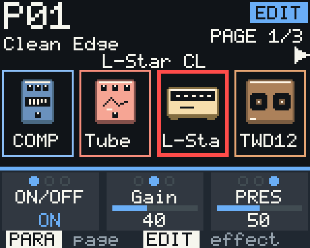
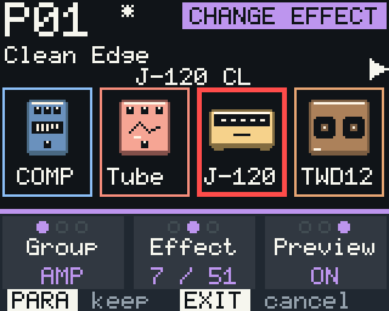
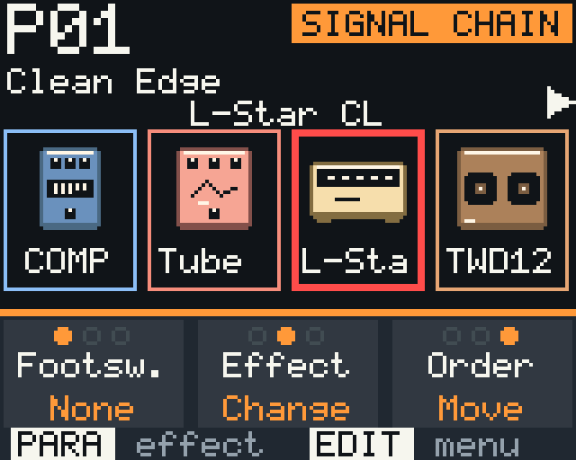
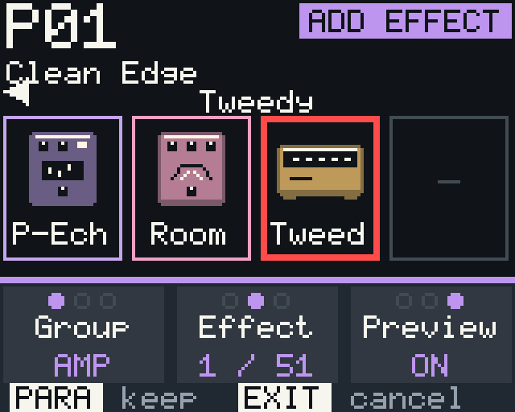
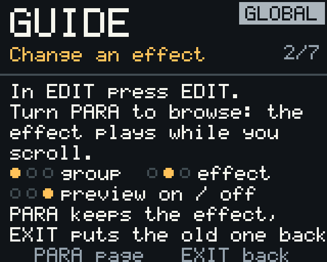

# OpenGP100 on the pedal: how to use the editor

Our build of OpenGP100 reworks the buttons of the Edit and Signal Chain screens. This page is the same text as the on-pedal
guide (**GLOBAL > Guide**, or hold GLOBAL on any screen to open the page for the screen you are on).

  
  
  
  
  

## Modes

Every screen shows its mode as a colored tag in the top right corner:

| Tag | Color | Where |
| --- | --- | --- |
| PLAY | green | normal playing |
| EDIT | blue | edit one effect |
| SIGNAL CHAIN | orange | add / remove / reorder effects |
| CHAIN MENU, ASSIGN EXP | orange | the EDIT menu of the chain, expression-pedal assignment |
| ADD EFFECT, CHANGE EFFECT | purple | the effect list |
| SAVE, GLOBAL, TUNER, DRUM, LOOPER | red, grey, yellow, pink, teal | the other screens |

The line at the bottom always lists what the knobs and buttons do right now.

## The knobs: Q1, Q2, Q3

Under the screen are three identical knobs. We call them **Q1, Q2, Q3** (the Quick knobs), left to right. Whatever a knob does is shown
in the box above it: the **left box is Q1, the middle box is Q2, the right box is Q3**. Each box has three small circles; the filled one
shows which knob it is. A knob with nothing to do on a screen has no box. In the chain, the selected effect has a red frame and all
other effects have the same grey frame; a bypassed effect is darker. Buttons (PARA, EDIT, EXIT) are never shown in those boxes: they
appear as white chips on the bottom line, for example `[PARA] keep  [EXIT] cancel`.

## Rules

* **EXIT** goes back one step (effect list > signal chain > edit > play). It never keeps a change.
* **PARA press** confirms or acts on the selection. **PARA turn** moves the selection.
* **Hold PARA** switches between Edit and Signal Chain. **Hold GLOBAL** opens the guide for the current screen.
* A **\*** next to the preset number means unsaved edits. In Play, turning PARA with unsaved edits first shows **UNSAVED CHANGES**;
  turn PARA again to go on (the edits are lost) or press SAVE to keep them. The footswitches never ask, so switching presets on
  stage is always instant. The warning can be switched off in **GLOBAL > Editing** (Quick 3, "Unsaved": WARN / NO WARN).
* On the Edit and Signal Chain screens the bottom line alternates between two hints every second or two (for example `[HOLD PARA] signal chain`).
  Touch any control and the first hint comes back.

## Change an effect (Edit screen)

1. Turn PARA to select the effect in the chain.
2. Press **EDIT**. The effect list opens on the current effect.
3. Turn PARA to browse. The three boxes show **Group** (Q1: jumps to the next or previous group),
   **Effect** (Q2: steps through the effects of the group, same as turning PARA, with the position, e.g. `3 / 9`) and **Preview**
   (Q3: turn left for off, right for on). Turning past the last effect of a group goes back to the first one of the same group;
   Q1 is what changes the group.
4. The highlighted effect **plays while you scroll** (live preview). **PARA** keeps it, **EXIT** puts the old one back. Preview off
   (Q3) goes back to the sound from before and loads nothing while you browse; PARA still keeps the highlighted effect.

Parameters: press **PARA** for the next page (`PAGE 1/2`), turn Q1 to Q3 to change values.

## Signal Chain

Hold PARA in Edit. Turn PARA to select a slot. Signal Chain is for the structure of the preset; changing an effect is done in Edit.

* **PARA on [+]** adds an effect (same effect list, with live preview). **PARA on an effect** does nothing.
* **Q1** (Footsw.) footswitch assignment, **Q3** (Order) move the effect. Q2 is not used here.
* **EDIT** opens a menu: Insert before, Remove, Assign EXP, **Clear preset**.
* **EXIT** goes back to Edit.

### Clear preset (start from scratch)

EDIT > **Clear preset** asks "Clear preset? Removes all N effects". **PARA** clears, **EXIT** cancels. Every effect goes, together with its
footswitch and expression-pedal assignments; the name, tempo and preset volume stay. Right afterwards the bottom line says
"Cleared - EXIT undo": EXIT brings everything back until you do something else. Nothing is saved until you press SAVE.

An empty preset points you here: the Edit screen says "Hold PARA to add effects" (effects are added in Signal Chain; EDIT in Edit only
replaces the selected effect).

### Removing

Removing with the menu, or (if enabled) by holding EDIT, shows "Removed - EXIT to undo". EXIT right after restores the effect with
its settings; any other action makes the removal final.

**GLOBAL > Editing > Hold EDIT** (off by default) lets you remove the selected effect in the Signal Chain by holding EDIT.
The same page has **Unsaved** (on by default): the "UNSAVED CHANGES" warning in Play when you turn PARA with unsaved edits.

## Live preview

While you browse the effect list, the highlighted effect is loaded once the PARA knob has been still for a moment (so fast turning
does not load every effect). If you dislike a sound change or small click while scrolling, untick **live preview** in the
GP-100 Firmware Builder when you make the update file: effects then load only when you press PARA.
